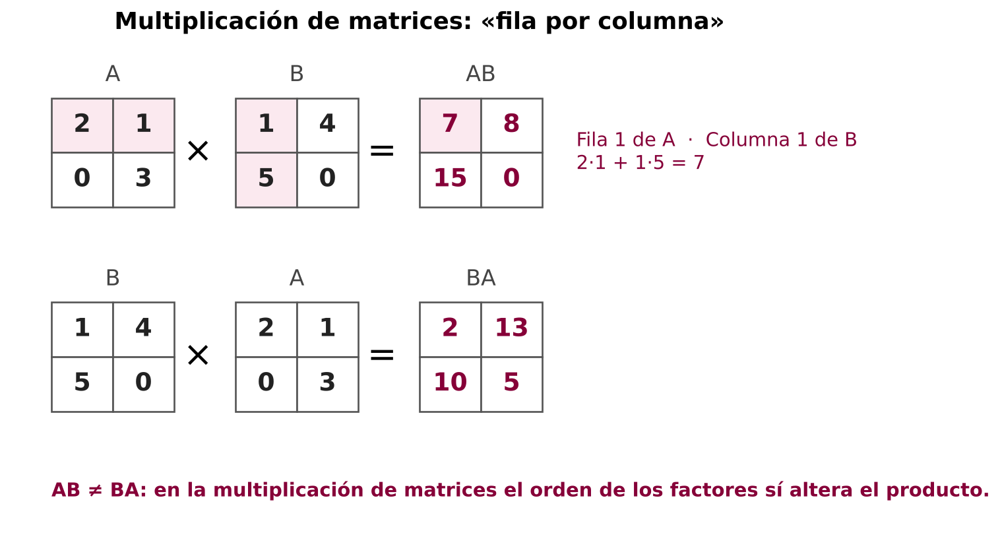
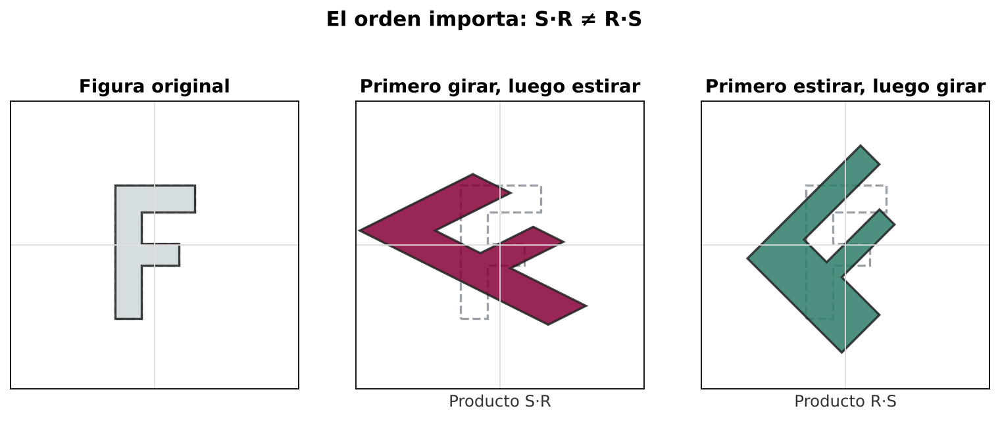
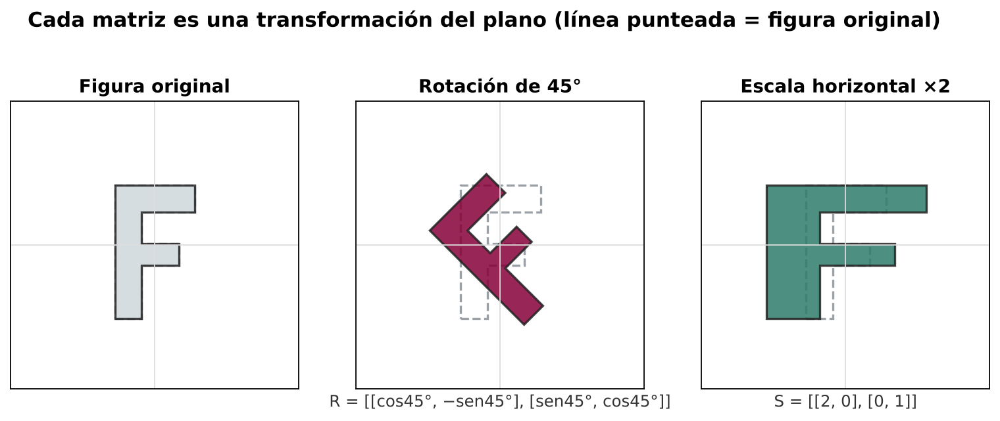

  

# Artículo de Investigación sobre la Creatividad

**Integrantes:** 
-Donaldo Bejerano Santos
-Nohemi Justavino
-Orlenis Montezuma
-Ariel Molina
-Carlos Miranda

**Disciplina Seleccionada:** Matemática (operaciones con matrices)  
**Fecha:** Octubre de 2026  

---

## 1. Introducción

La creatividad suele asociarse con el arte, la música o el diseño, y muy pocas veces con la matemática, a la que muchos estudiantes perciben como un conjunto de reglas fijas que se memorizan y se aplican. Sin embargo, quienes han construido esta ciencia coinciden en que detrás de cada definición, teorema o método hay una decisión inventiva: alguien se preguntó qué pasaría si se combinaban objetos de una manera nueva. En el contexto actual, marcado por la inteligencia artificial, el análisis de datos y los gráficos por computadora, la capacidad de pensar con flexibilidad y de ver un mismo problema desde varios ángulos se ha vuelto tan importante como el dominio de los procedimientos.

Este artículo explora la creatividad en la matemática a través de un tema concreto: las **operaciones con matrices** (suma, multiplicación por un escalar, multiplicación de matrices, transposición e inversión). Se eligió este contenido porque suele enseñarse de forma muy mecánica, "fila por columna", cuando en realidad su origen y sus aplicaciones son un ejemplo notable de invención matemática. El objetivo es mostrar cómo se entiende la creatividad en esta disciplina, qué ejemplos reales la evidencian, qué estrategias permiten fomentarla en el aula y cuál ha sido su impacto en el avance del conocimiento.

## 2. Desarrollo: La Creatividad en la Matemática (operaciones con matrices)

### 2.1 Definición de la creatividad

En el ámbito matemático, la creatividad no se limita a descubrir resultados que nadie había obtenido antes. Sriraman (2009) la describe como un proceso que da lugar a soluciones inusuales o perspicaces a un problema, o a la formulación de nuevas preguntas que permiten mirar un problema antiguo desde otro ángulo. De acuerdo con Leikin (2009), tres componentes permiten reconocerla en la práctica: la **fluidez** (producir muchas ideas o caminos), la **flexibilidad** (cambiar de estrategia o de representación) y la **originalidad** (proponer algo poco común en el grupo). Hadamard (1945), por su parte, estudió cómo los matemáticos inventan y destacó el papel de la intuición y de los periodos de reflexión previos a la idea clara.

Aplicado a las matrices, ser creativo significa mucho más que calcular un producto sin errores. Implica, por ejemplo, comprender que una matriz puede verse como una tabla de datos, como un sistema de ecuaciones o como una transformación del plano, y moverse con libertad entre esas interpretaciones según convenga al problema. También supone preguntarse por qué la multiplicación de matrices **no es conmutativa**, o qué condiciones debe cumplir una matriz para tener inversa, en lugar de aceptar esas reglas como hechos arbitrarios. En síntesis, la creatividad matemática se manifiesta cuando el estudiante o el investigador da sentido, conecta y extiende lo que ya conoce.

### 2.2 Ejemplos de creatividad aplicada

El primer ejemplo es histórico. **Arthur Cayley**, en su memoria de 1858 sobre la teoría de matrices, definió el producto de matrices de una manera que a primera vista parece poco natural, pero que responde a una idea brillante: que multiplicar matrices equivale a **componer transformaciones lineales**, es decir, aplicar una transformación y luego otra (Cayley, 1858). Esa decisión explica por qué el orden de los factores importa y por qué el producto exige que el número de columnas de la primera matriz coincida con el número de filas de la segunda. Lo que parece una regla caprichosa es en realidad una elección ingeniosa que hace coherente toda la teoría.

Un ejemplo sencillo permite ver esto en acción. Sean A = [[2, 1], [0, 3]] y B = [[1, 4], [5, 0]], donde cada corchete interior representa una fila. Al calcular AB se obtiene [[7, 8], [15, 0]], mientras que BA da [[2, 13], [10, 5]]. Los resultados son distintos, y ahí surge la pregunta creativa: ¿qué significa que el orden altere el resultado? Si A y B se interpretan como transformaciones del plano, la respuesta es intuitiva, ya que no es lo mismo girar una figura y luego estirarla que estirarla y luego girarla. Un estudiante que llega a esta conclusión por su cuenta ha hecho un pequeño descubrimiento y no solo una operación.

   
  <em>Figura 1. Producto AB y BA con las mismas matrices: los resultados son distintos.</em>

   
  <em>Figura 2. Girar y luego estirar no es lo mismo que estirar y luego girar (S·R ≠ R·S).</em>

Un segundo ejemplo está en los gráficos por computadora. Para girar una figura un ángulo θ alrededor del origen se utiliza una **matriz de rotación** formada por cos θ y sen θ, y para agrandarla o reducirla basta con multiplicarla por una matriz de escala. Cuando se desea aplicar varias transformaciones seguidas (girar, escalar y desplazar), la creatividad consiste en multiplicar primero todas las matrices para obtener una sola, de modo que cada punto se transforme con una única operación. Así funcionan, en esencia, los motores de videojuegos y los programas de diseño y animación.

   
  <em>Figura 3. Una matriz de rotación y una de escala aplicadas a una misma figura.</em>

Un tercer caso proviene de la criptografía. En 1929, Lester Hill propuso un **sistema de cifrado** en el que bloques de letras se convierten en números y se multiplican por una matriz clave; para descifrar el mensaje se utiliza la matriz inversa (Hill, 1929). Es una forma inventiva de usar la inversión de matrices para proteger información, y hoy se emplea en las aulas como actividad motivadora para practicar el producto y la inversa de manera significativa.

Finalmente, el buscador de Google se apoyó en una idea matricial. **Brin y Page (1998)** representaron la red de páginas web mediante una matriz de enlaces y, al estudiar cómo se comporta esa matriz cuando se multiplica repetidas veces por un vector, lograron asignar una importancia a cada página. Un problema que parecía puramente informático se resolvió mirándolo como un problema de álgebra lineal, lo cual ilustra la flexibilidad de pensamiento descrita anteriormente.

### 2.3 Métodos o técnicas para fomentarla

En la enseñanza de las matrices existen varias estrategias que impulsan el pensamiento creativo en lugar de la repetición de algoritmos. La primera es la **resolución de problemas** siguiendo las fases propuestas por Polya (1965): comprender el problema, concebir un plan, ejecutarlo y examinar la solución obtenida. Esta última fase es clave, porque invita a verificar el resultado y a preguntarse si el problema se podía resolver por otro camino.

Una segunda técnica son las **tareas de soluciones múltiples**. Leikin (2009) muestra que pedir al estudiante que resuelva un mismo problema de varias maneras desarrolla su flexibilidad y su originalidad. Por ejemplo, un sistema de ecuaciones puede resolverse por sustitución, por eliminación, con la matriz inversa o con operaciones entre filas, y luego el grupo puede comparar cuál método resulta más eficiente según el caso.

Una tercera estrategia es la **formulación de problemas**. Silver (1997) sostiene que la creatividad se fortalece cuando los estudiantes no solo resuelven ejercicios, sino que los inventan o los modifican. En el tema de matrices se puede pedir que diseñen una situación real (por ejemplo, ventas de varios productos en distintas sucursales, o rutas entre ciudades) y que la representen con matrices y operaciones. También se puede plantear una pregunta abierta, como: ¿existen dos matrices A y B tales que AB sea igual a BA? ¿Siempre ocurre lo mismo?

Otras técnicas complementarias son el uso de **múltiples representaciones** (tablas, esquemas, transformaciones geométricas) y el apoyo de la tecnología. Herramientas como GeoGebra o librerías de programación como NumPy permiten experimentar, comprobar conjeturas y visualizar cómo una matriz deforma una figura, lo que libera tiempo del cálculo manual para dedicarlo al razonamiento. Por último, conviene tratar **el error como una oportunidad de aprendizaje**: cuando un estudiante intenta multiplicar matrices de tamaños incompatibles, la discusión sobre por qué no es posible refuerza el significado de la operación (Lay, 2012).

Vale la pena mencionar también el trabajo colaborativo. Cuando los estudiantes comparan en parejas sus propias formas de organizar los datos en una matriz y de justificar un resultado, aparecen ideas distintas que enriquecen al grupo. El docente cumple entonces el papel de guía: formula preguntas, propone desafíos de dificultad creciente y valora el razonamiento por encima de la rapidez.

### 2.4 Impacto en el desarrollo y avance

La creatividad ha sido el motor del desarrollo de la teoría de matrices. Cuando Cayley definió el producto de matrices y exploró sus propiedades, abrió el camino para el **álgebra lineal moderna**, una rama que hoy sostiene gran parte de la ingeniería, la física, la economía y las ciencias de la computación. Sin esa invención no existirían las bases de métodos como la resolución de grandes sistemas de ecuaciones, el análisis de datos o los algoritmos de aprendizaje automático, que representan información en forma de matrices y la transforman mediante operaciones matriciales.

En el plano educativo, el impacto también es relevante. Cuando las operaciones con matrices se enseñan solo como procedimientos, el estudiante tiende a olvidarlas; cuando se vinculan con aplicaciones y con preguntas abiertas, se comprenden mejor y se recuerdan por más tiempo. Fomentar la creatividad en este tema contribuye, además, a desarrollar habilidades que se transfieren a otros ámbitos: modelar situaciones reales, buscar caminos alternativos y justificar decisiones con argumentos.

## 3. Conclusión

La matemática y la creatividad **se complementan y se enriquecen mutuamente**. La matemática ofrece un lenguaje preciso y un conjunto de estructuras, como las matrices, que permiten expresar y resolver problemas con rigor; la creatividad aporta la capacidad de imaginar nuevas definiciones, de conectar ideas aparentemente distantes y de formular preguntas que impulsan el avance de la disciplina. Sin rigor, la creatividad pierde el rumbo; sin creatividad, el rigor se convierte en una rutina vacía.

El caso de las operaciones con matrices lo demuestra con claridad: el producto definido por Cayley, el cifrado de Hill, las transformaciones gráficas y el algoritmo de Brin y Page nacieron de mirar los mismos objetos de maneras distintas. Para los docentes, esto implica un reto y una oportunidad: diseñar clases donde los estudiantes exploren, comparen estrategias, inventen problemas y utilicen la tecnología, de modo que el aprendizaje de las matrices no sea solo calcular, sino comprender y crear.

## 4. Referencias Bibliográficas

1. Brin, S., y Page, L. (1998). The anatomy of a large-scale hypertextual Web search engine. *Computer Networks and ISDN Systems, 30*(1-7), 107-117.
2. Cayley, A. (1858). A memoir on the theory of matrices. *Philosophical Transactions of the Royal Society of London, 148*, 17-37.
3. Hadamard, J. (1945). *The psychology of invention in the mathematical field*. Princeton University Press.
4. Hill, L. S. (1929). Cryptography in an algebraic alphabet. *The American Mathematical Monthly, 36*(6), 306-312.
5. Lay, D. C. (2012). *Álgebra lineal y sus aplicaciones* (4.ª ed.). Pearson Educación.
6. Leikin, R. (2009). Exploring mathematical creativity using multiple solution tasks. En R. Leikin, A. Berman y B. Koichu (Eds.), *Creativity in mathematics and the education of gifted students* (pp. 129-145). Sense Publishers.
7. Polya, G. (1965). *Cómo plantear y resolver problemas*. Trillas.
8. Silver, E. A. (1997). Fostering creativity through instruction rooted in mathematical problem solving and problem posing. *ZDM, 29*(3), 75-80.
9. Sriraman, B. (2009). The characteristics of mathematical creativity. *ZDM, 41*(1-2), 13-27.

---
